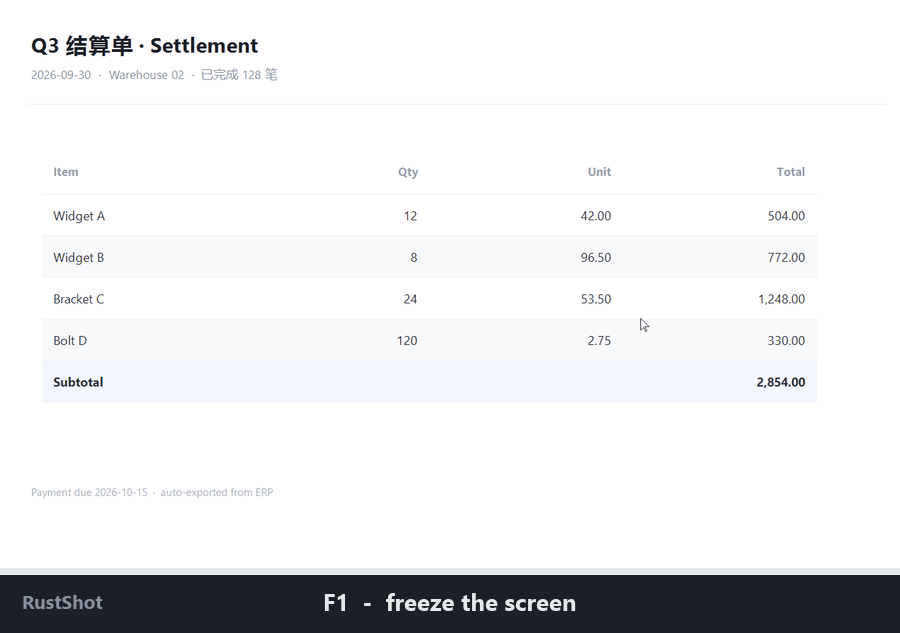
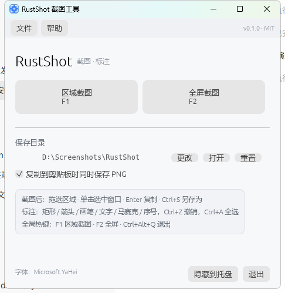
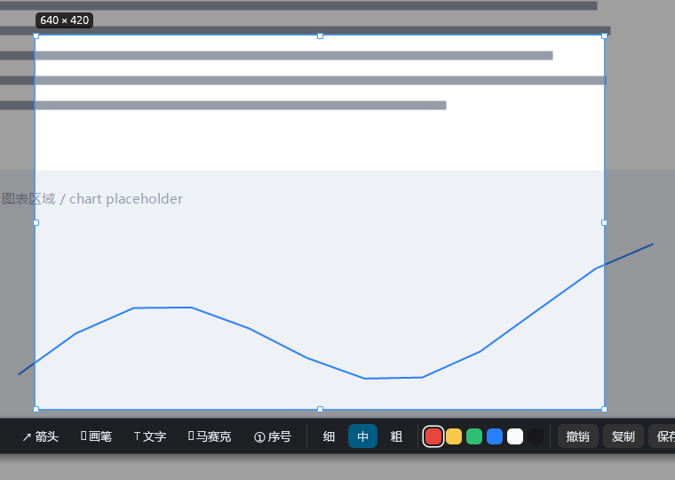

# RustShot

**A tiny screenshot & annotation tool for Windows: press `F1`, drag a region, add a few marks, hit Enter to copy.**
One portable exe, or a Setup.exe that installs machine-wide into `C:\Program Files`; no runtime, and the config travels with the exe.

**English** · [简体中文](README.md)

[](https://github.com/i314q159/rust_shot)
[](https://github.com/i314q159/rust_shot/releases)
[](https://www.rust-lang.org/)
[](LICENSE-MIT.md)
[](#download)
[](#download)
[](#limitations--faq)

<p align="center">
  
</p>

<p align="center"><sub>`F1` freezes the screen → drag a region → `2` box `3` arrow `7` number → `Enter` to copy (5 seconds, no audio)</sub></p>

<p align="center">
  
</p>

<p align="center"><sub>The panel: tray residency, save folder, hotkey hints — light chrome that stays readable on top of an image</sub></p>

---

## Contents

- [Features](#features)
- [Workflow](#workflow)
- [Use cases](#use-cases)
- [Hotkeys](#hotkeys)
- [Download](#download)
- [Command line](#command-line)
- [Configuration](#configuration)
- [Build from source](#build-from-source)
- [Implementation notes](#implementation-notes)
- [Project layout](#project-layout)
- [Limitations / FAQ](#limitations--faq)
- [License](#license)

---

## Features

**Capture** — `F1` lets you drag a region; after releasing you can still drag the corners / edges or move the whole selection, and a plain click picks the window under the cursor (real DWM bounds, no shadow). `F2` grabs the whole screen and opens the same annotation tools with everything preselected — Enter copies, or drag to narrow it down. Per-Monitor V2: on multi-monitor or high-DPI setups it freezes the monitor under the cursor at 1:1 physical pixels.

**Annotate** — `1`–`7` switch tools; preview and export share the same geometry, so what you see is what you get.

| Key | Tool | What it does |
| --- | --- | --- |
| `1` | Select | move / resize the selection |
| `2` | Rect | outlined rectangle |
| `3` | Arrow | straight line with a filled head |
| `4` | Pen | freehand, round caps |
| `5` | Text | edit in place, IME friendly |
| `6` | Mosaic | pixelates using local average colour |
| `7` | Number | auto-incrementing badge |

3 line widths, 6 colours, `Ctrl+Z` undoes stroke by stroke.

<p align="center">
  
</p>

<p align="center"><sub>After dragging: dimmed mask outside the selection, live size tag, toolbar (`1`–`7` switch tools · 3 widths · 6 colours · undo / copy / save)</sub></p>

**Output** — `Enter` / `Ctrl+C` copy to the clipboard (optionally also saving a PNG); `Ctrl+S` saves as, appending `_1` / `_2` instead of overwriting; `Esc` or right-click cancels.

**Stays out of the way** — launching it (double click, Start Menu, autostart) is a tray app: the window is moved off screen before the first frame, so nothing flashes, and F1 / F2 work right away. Open the panel with `--panel` or the tray menu. The × button also hides to the tray (parked off screen and removed from the taskbar, so it never shows up in Alt+Tab). Left click on the tray icon starts a capture, right click switches region / full screen / panel / quit; single instance, so launching again never opens a second copy.

**Update check / silent update** — `Help → Check for updates` reads the GitHub release page and compares it with the running version. When something is newer, `Update now` downloads the installer in the background, verifies it against the release's `SHA256SUMS.txt`, then installs silently and restarts the app — one UAC prompt in total. A cancelled UAC or a checksum mismatch leaves the current install untouched. `Open releases page` is still there for a manual download, and an `Update vX.Y.Z` badge appears in the top right corner. Tick "Install new versions silently" (`auto_update = 'silent'` in `config.toml`) and a check that finds a newer build starts that flow right away. It only goes online when you click it; if `api.github.com` is unreachable it falls back to the redirect of the releases page.

**Update proxy** — `Help → Proxy` picks `system proxy / direct / manual address` (`proxy = 'system' | 'direct' | '127.0.0.1:12334'` in `config.toml`; a bare port works too). It only affects the update check and download, and applies to the next check — handy when the system proxy is off but a local proxy is running.

**Theme** — the top bar `Theme` menu switches `Follow system / Light / Dark`. By default it follows the Windows light/dark setting: changing the system theme recolours the panel and the capture toolbar without a restart. A pinned theme is written to `config.toml` and stops following the system.

**Language** — the UI is bilingual (Chinese / English) and follows the Windows display language by default. The top bar `Language` menu switches `Follow system / 中文 / English`, the choice is written to `config.toml`, and it applies immediately to the window title, tray menu, capture toolbar and installer UI.

**Why not Snipaste / Snipping Tool**

| | RustShot | Snipping Tool | Snipaste |
| --- | --- | --- | --- |
| Size | one small exe, no runtime | built in | installer + deps |
| Annotation | 6 tools + numbers + mosaic | basic pen | complete (pin, picker) |
| Portable config | `config.toml` travels with the exe | — | partly configurable |
| Pin / OCR / scrolling capture | not supported | not supported | pin yes, OCR no |

The trade-off is deliberate: do the one path — freeze → select → annotate → deliver — with no extra steps.

## Workflow

```
        F1                  drag / click                   1-7
  ┌───────────┐   ┌──────────────────────────┐   ┌────────────────────┐
  │ freeze    │ → │ selection (adjustable)   │ → │ rect/arrow/text/… │
  │ the screen│   │ + toolbar                │   │                    │
  └───────────┘   └──────────────────────────┘   └─────────┬──────────┘
                                                            │
                              ┌─────────────────────────────┴───────────────┐
                              │  Enter copy   ·   Ctrl+S save as   ·   Esc   │
                              └──────────────────────────────────────────────┘
```

The screen is frozen the moment you press `F1` (GDI `BitBlt` + `CAPTUREBLT`): windows keep scrolling and videos keep playing behind it, but you are annotating that exact frame.

## Use cases

The four everyday paths, each finished in "press a key → drag → Enter".

### 1. Point at the error before filing an issue

```
F1 → drag around the error window → 2 box the failing line → 7 add a number → Enter
```

Paste it straight into GitHub or Jira. The demo at the top walks this path: a red box around the wrong total, an arrow pointing at it, a `1` badge on the spot under discussion.

### 2. Put your own verdict on the screenshot

```
F1 → drag → 3 arrow from the conclusion to the data → 5 type "this does not add up" → Enter
```

Text is edited in place, IME included; `Ctrl+Z` undoes stroke by stroke, so a crooked line never costs a redo.

### 3. Redact before sending

```
F1 → drag → 6 brush the name / phone / intranet host with mosaic → Ctrl+S
```

The mosaic replaces pixels with local averages, so the exported PNG really contains no readable text — it is not a translucent overlay.

### 4. Produce a whole series for documentation

```
capture → Ctrl+S (duplicates become _1 / _2) → drop straight into Word or your wiki
```

With "Also save a PNG when copying" enabled, a single `Enter` puts the image on the clipboard and writes the file at the same time.

| Scenario | Tools | Result |
| --- | --- | --- |
| Bug reports / issues | `F1` + rect + number | clipboard image |
| Reviews and walkthroughs | `F1` + arrow + text | clipboard image |
| Screenshots with private data | `F1` + mosaic | PNG file |
| Docs and tutorials | `F1` / `F2` + auto-save | PNG series |

## Hotkeys

| Hotkey | Action |
| --- | --- |
| `F1` | region capture |
| `F2` | full screen capture into the annotation tools (all selected, Enter copies) |
| `Ctrl+Alt+S` | region capture (backup, in case another app owns `F1`) |
| `Ctrl+Alt+Q` | quit |

While capturing: `1`–`7` pick a tool, `Ctrl+Z` undo, `Ctrl+A` select all, `Enter` / `Ctrl+C` copy, `Ctrl+S` save, `Esc` / right click cancel.

## Download

Two ways to run it, pick one.

### Installer (recommended)

Download `RustShot-Setup-<version>.exe` from [Releases](https://github.com/i314q159/rust_shot/releases), double click, confirm one UAC prompt. The installer offers English and 简体中文 and preselects the Windows language.

| Item | Where |
| --- | --- |
| Program | `C:\Program Files\RustShot\` (all users) |
| Start Menu | `RustShot`, `Uninstall RustShot` |
| Desktop icon | opt-in during setup |
| Autostart | opt-in, writes `HKLM\…\Run` with `--tray` (silent tray start, same as a double click) |
| Command line | opt-in, adds the install folder to the system `PATH` so `rust_shot` works anywhere |
| Uninstall | Settings → Apps → RustShot, or the Start Menu entry |

The installer only writes to `C:\Program Files\RustShot`, never to a user folder. Uninstalling removes the shortcuts, the autostart value and the PATH entry (everything else in PATH is kept); screenshots and the settings in `%LOCALAPPDATA%\RustShot` are left alone.

### Portable

Download `rust_shot.exe` and run it:

1. The first start creates `config.toml` **next to the exe**;
2. In a read-only folder such as `Program Files` it falls back to `%LOCALAPPDATA%\RustShot\`;
3. To change the save folder use `Change` in the panel, or edit `config.toml`.

Idle footprint is about 65 MB private (≈100 MB working set); there is no background service and no network activity.

## Command line

```powershell
rust_shot.exe                  start in the tray, no panel (already running: exit quietly)
rust_shot.exe --panel, --show  start with the main panel (brings up a running copy's panel)
rust_shot.exe --capture, -c    region capture right away (forwarded to a running copy)
rust_shot.exe --full, -f       full screen to the clipboard (no overlay, for scripts)
rust_shot.exe --tray, --silent  same as no arguments, used by autostart
rust_shot.exe --selftest a.png  render a test image off screen and exit
rust_shot.exe --help, -h       usage
```

## Configuration

Settings live in **`config.toml` next to the exe** — plain TOML, editable in Notepad:

```toml
# RustShot config (restart to apply; save_dir accepts %USERPROFILE% variables)
# theme: system | light | dark   lang: system | zh | en
# auto_update: notice | silent   proxy: empty follows Windows | direct | 7890 | host:port

save_dir = '%USERPROFILE%\Pictures\RustShot'
auto_save = true
theme = 'system'
lang = 'system'
auto_update = 'notice'
proxy = 'system'
```

Paths are written as single-quoted TOML literal strings, so `C:\Users\…` needs no double backslashes; a value containing a single quote is re-emitted as a double-quoted string automatically.

| Key | Meaning |
| --- | --- |
| `save_dir` | where PNGs go; `%USERPROFILE%`, `%TEMP%` and friends are expanded |
| `auto_save` | also write a PNG when copying to the clipboard (`true` / `false`) |
| `theme` | `system` follows Windows, `light`, `dark` — the same switch as the top bar `Theme` menu |
| `lang` | `system` follows Windows, `zh`, `en` — the same switch as the top bar `Language` menu |
| `auto_update` | `notice` only reports in the dialog (default) / `silent` installs a newer release as soon as a check finds one; same switch as the checkbox in the update dialog |
| `proxy` | proxy for the update check/download: `system` follows Windows (default), `direct`, `7890` (implies `127.0.0.1`), `host:port`; same switch as `Help → Proxy` |

`Change` / `Reset` in the panel and the `Theme` / `Language` menus write the file immediately. The `config.txt` used by older builds (next to the exe or in `%LOCALAPPDATA%\RustShot`) is imported on first start and rewritten as `config.toml`; the old file is kept as `config.txt.bak`.

Diagnostics: `%LOCALAPPDATA%\RustShot\rustshot.log` (startup, errors and panics only).

## Build from source

```powershell
git clone https://github.com/i314q159/rust_shot.git
cd rust_shot
cargo build --release
# artifact: target\release\rust_shot.exe
```

An MSVC toolchain is required (`rustup default stable-msvc`). `build.rs` embeds `assets/icon/rustshot.ico` into the exe resources; a machine without `rc.exe` only warns and still builds.

### Build the installer

```powershell
winget install JRSoftware.InnoSetup      # once
pwsh -File installer\build.ps1           # release build + copy exe + compile setup + silent install
# output: outputs\RustShot-Setup-<version>.exe, also refreshes outputs\rust_shot.exe
# install log: outputs\install-<version>.log
```

The script is `installer\rust_shot.iss` (Inno Setup 6); the version comes from `Cargo.toml`, so it is never written twice. The setup always installs to `C:\Program Files\RustShot` with four pages: welcome → additional tasks → install → finish. UI texts are English and 简体中文 (`installer\lang\*.isl`; `/LANG=english` skips the language prompt).

`build.ps1` installs the package it just built, silently, unless told otherwise. If RustShot is running it closes it first (forcefully if needed) so the installer's mutex check cannot block the silent run, then verifies the version in the uninstall registry.

| Flag | Effect |
| --- | --- |
| `-NoInstall` | build and package only |
| `-Interactive` | show the installer progress instead of a fully silent run |
| `-KeepAppRunning` | do not close a running RustShot; the script stops with an error instead |

Unattended install / uninstall (for distribution scripts):

```powershell
RustShot-Setup-0.1.1.exe /VERYSILENT /SUPPRESSMSGBOXES /NORESTART
"C:\Program Files\RustShot\unins000.exe" /VERYSILENT /SUPPRESSMSGBOXES /NORESTART
```

`build.ps1` runs the first one. Both need administrator rights; the package refuses `/CURRENTUSER` and never writes to `%LOCALAPPDATA%`.

### Tests

```powershell
cargo fmt --check
cargo clippy --all-targets -- -D warnings
cargo test          # 45 tests: arrow geometry, badge contrast, selection clamping, handle hit tests,
                    # config parsing / env expansion, export rendering of all six annotations, i18n
```

## Implementation notes

| Concern | Approach |
| --- | --- |
| Screen capture | GDI `BitBlt` + `CAPTUREBLT` (layered windows included), `GetDIBits` for BGRA → RGBA |
| DPI | process is Per-Monitor V2 and stays in physical pixels; the overlay is pinned to the monitor with `SetWindowPos` |
| Overlay | the frozen frame is a full-window background texture plus a dim mask outside the selection — no real transparent window needed |
| Coordinates | annotation geometry is stored in frame-local physical pixels, so preview and export agree to the pixel |
| Annotation preview | egui `Painter` for rect / arrow / pen / mosaic, `TextEdit` for text so IMEs work |
| Export | `tiny-skia` draws vectors (antialiased), `fontdue` rasterises text, composited into the cropped RGBA |
| Hotkeys / tray / single instance | a dedicated thread with a hidden message window: `RegisterHotKey`, a mutex for single instance, tray menu events queued to wake the UI |
| Update check | WinHTTP (built into Windows, no TLS dependency) on a background thread, `/releases/latest` redirect as fallback, a ~100-line scanner reads the JSON fields (no serde) |
| Theme | `HKCU\…\Themes\Personalize\AppsUseLightTheme` decides light/dark; a hidden top-level window listens for `WM_SETTINGCHANGE`, both palettes are registered, and the panel and capture toolbar share one palette |
| Language | texts are written as `tr("中文", "English")` at the call site; `src/i18n.rs` only tracks the current language, detects the Windows UI language and fills `{}` placeholders; switching also retitles the window and the tray menu |
| Fonts | nothing is bundled: system fonts are probed in a fixed order (Microsoft YaHei → SimHei → SimSun → Segoe UI) and shared by the UI and the exporter |
| Panel | eframe/egui; `logic()` handles events (also while hidden), `ui()` paints and hosts the overlay viewport |
| Icon | multi-size PNG/ICO under `assets/icon/`; the window and tray use the PNGs, `build.rs` puts the ICO into the exe resources |

## Project layout

```
rust_shot/
├─ src/
│  ├─ main.rs      command line, single-instance forwarding, self test
│  ├─ app.rs       panel UI, menu bar, tray, clipboard / save plumbing
│  ├─ overlay.rs   frozen overlay: selection, annotation, toolbar
│  ├─ shapes.rs    annotation model, egui preview, tiny-skia/fontdue export
│  ├─ capture.rs   GDI screen capture, monitor / window geometry
│  ├─ worker.rs    hotkey thread, single-instance IPC
│  ├─ update.rs    GitHub release check (WinHTTP + minimal JSON scan)
│  ├─ i18n.rs      Chinese / English UI texts
│  ├─ config.rs    portable config, unique file names
│  ├─ fonts.rs     system CJK font loading (egui + fontdue)
│  ├─ win.rs       window placement in physical pixels
│  └─ util.rs      timestamps, logging
├─ assets/
│  ├─ icon/        icon sources (ICO + 16–256 px PNGs + preview)
│  ├─ screenshot-panel.png
│  └─ screenshot-overlay.png
├─ installer/
│  ├─ rust_shot.iss   Inno Setup 6 script (Program Files, shortcuts, PATH, autostart, uninstall)
│  ├─ lang/           English / Chinese message overrides
│  └─ build.ps1       build, package and silently install
├─ build.rs        embeds the ICO into the exe resources
├─ LICENSE-MIT.md
├─ README.md       (简体中文)
└─ README.en.md    (English)
```

## Limitations / FAQ

**Windows 10 / 11 only** — it leans on Win32 (GDI, DWM, `RegisterHotKey`).

**The screenshot is black?** Content protected by DRM (some players, protected windows) comes back as a black frame; that is the system, not the tool.

**Does the panel pop up when I use a hotkey from the tray?** No. Hiding to the tray is not minimising: the panel is parked outside every monitor and removed from the taskbar, and eframe can still host the capture overlay on it. Only a panel you minimised by hand has to be restored for the overlay (and it goes back afterwards).

**Does the update check phone home?** No. It requests GitHub once, when you click it, through WinHTTP (so your system proxy applies); failures are reported and not retried.

**What does "Update now" actually do?** A background thread downloads the release installer into `%TEMP%\RustShot\update\` and compares its SHA-256 with the release's `SHA256SUMS.txt`. Only on a match does a hidden helper take over: wait for the app to exit, run the setup with `/VERYSILENT` (that one UAC prompt cannot be avoided — it writes to `Program Files` and `HKLM`), then start the new build with `--panel`. A checksum mismatch, a broken download or a cancelled UAC leaves the current install exactly as it was. Auto-update is installed-copy only: a portable build is a bare exe, so the dialog just points at the releases page for a fresh portable zip.


**Nothing appeared when I double-clicked?** That is intended: RustShot is a tray app, so starting it (including autostart) does not open a panel — press F1 / F2 and capture right away. To see the panel, right click the tray icon → Show panel, or run `rust_shot --panel`. Launching it again while it is running just exits quietly.

**Not planned**: scrolling capture, colour picker, OCR, pinning, silent auto-update.

**Want a different annotation?** Open an issue and describe the scenario — that is more useful than silence.

**Credits**: the tool stands on the Rust ecosystem, GitHub (hosting and CI), VS Code / CodeBuddy / WorkBuddy (development and collaboration), and QwenWork and DeepSeek (AI assistance) — see [ACKNOWLEDGEMENTS.en.md](ACKNOWLEDGEMENTS.en.md).

## License

[MIT](LICENSE-MIT.md) © 2026 i314q159 — also viewable in the app: `Help → License (MIT)`.

---

<p align="center"><sub>If this little tool saved you a few round trips, a ⭐ Star is appreciated.</sub></p>
