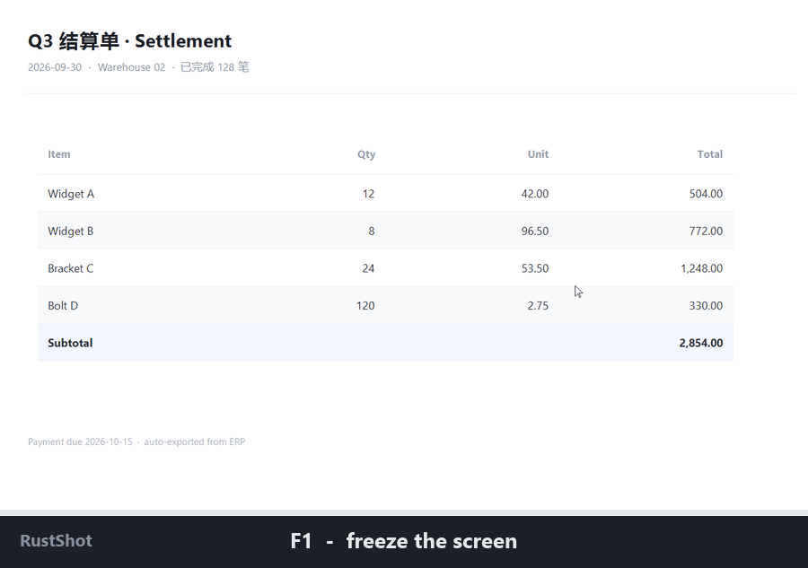
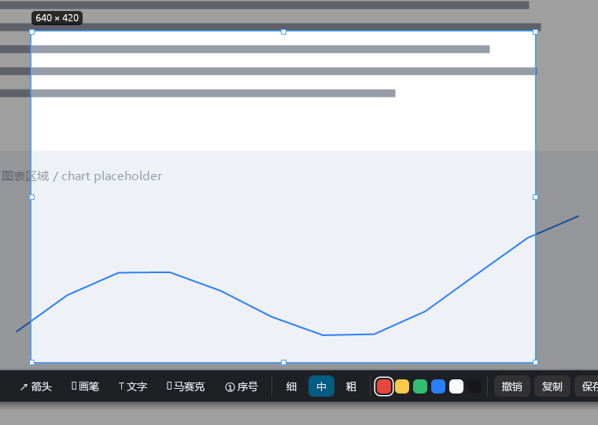
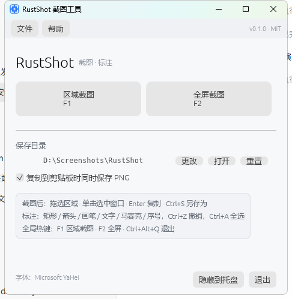

# RustShot

  

**RustShot is a lightweight screenshot and annotation tool for Windows.** Hit a hotkey to freeze the screen, pick the area you want, add boxes, arrows, text, or a mosaic, then copy or save it. It sits quietly in the system tray after launch, so it never interrupts your work—perfect for turning “what you see” into “what you mean.”

## Why RustShot

### Fast capture

- `F1` for area capture; `F2` for full-screen capture with annotation
- Drag to select a region, or single-click to pick a window
- Move and resize the selection before you confirm it
- `Enter` or `Ctrl+C` to copy; `Ctrl+S` to save as PNG

### Just-right annotations

Seven built-in tools: Select, Rectangle, Arrow, Pen, Text, Mosaic, and Auto Number, with three line widths, six colors, and step-by-step undo. Write text directly onto the image, and mosaics are baked into the exported content—so names, phone numbers, and other sensitive details stay hidden before you hit send.

  

### Stays out of your way

It lives in the tray after startup—no main window, no Alt+Tab entry, and no second instance when you reopen it. When you need to adjust settings, open the main panel from the tray menu.

  

### Handy settings

Chinese / English interface, light / dark theme, and an option to follow your system appearance. Save location, whether saving also happens on copy, and other everyday options are all in the panel.

### Always up to date

Check for new versions and open the releases page from within the app. The installed build supports one-click updates.

## Use cases

- **Bug reports**: Circle the error and number the reproduction steps.
- **Review walkthroughs**: Use arrows and text to tie a conclusion to the exact data.
- **Privacy cleanup**: Mosaic names, phone numbers, and internal addresses before sharing.
- **Docs and tutorials**: Save a series of images without overwriting files with the same name.

## Three steps to share

1. Press `F1` and drag over the area you want.
2. Press `1`–`7` to switch tools and add annotations.
3. Press `Enter` to copy, or `Ctrl+S` to save.

## Download

Get the Windows installer from [GitHub Releases](https://github.com/i314q159/rust_shot/releases). Supports Windows 10 / 11.

---

If it saves you a few back-and-forths, a Star is always appreciated.

